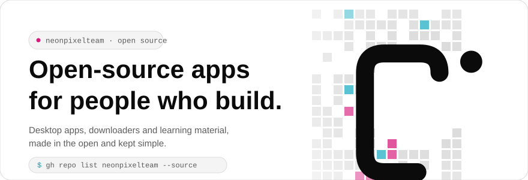
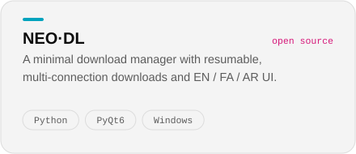
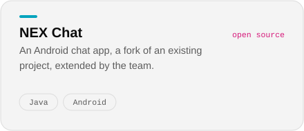
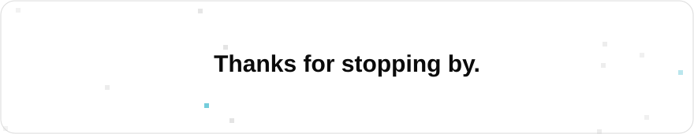

<picture><source media="(prefers-color-scheme: dark)" srcset="assets/hero-dark.svg"></picture>

 

<a href="https://github.com/neonpixelteam?tab=repositories&q=&type=source"><picture><source media="(prefers-color-scheme: dark)" srcset="assets/btn-projects-dark.svg"></picture></a>&nbsp;&nbsp;<a href="https://www.neonpixel.ir"><picture><source media="(prefers-color-scheme: dark)" srcset="assets/btn-web-dark.svg"></picture></a>

   

## Projects

<table>
<tr>
<td width="50%" valign="top">
<a href="https://github.com/neonpixelteam/neo-dl"><picture><source media="(prefers-color-scheme: dark)" srcset="assets/card-neodl-dark.svg"></picture></a>
</td>
<td width="50%" valign="top">
<a href="https://github.com/neonpixelteam/NEX_CHAT_APK"><picture><source media="(prefers-color-scheme: dark)" srcset="assets/card-nex-chat-dark.svg"></picture></a>
</td>
</tr>
</table>

  

## Toolbox

<picture><source media="(prefers-color-scheme: dark)" srcset="assets/toolbox-dark.svg"></picture>

  

## Connect

Star the projects you like, or get in touch to collaborate:
**Email** [neonpixelir@gmail.com](mailto:neonpixelir@gmail.com) &nbsp;·&nbsp; **Web** [neonpixel.ir](https://www.neonpixel.ir)

  

<picture><source media="(prefers-color-scheme: dark)" srcset="assets/footer-dark.svg"></picture>

