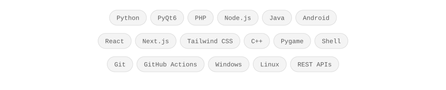

<picture><source media="(prefers-color-scheme: dark)" srcset="assets/hero-dark.svg"></picture>
  
<a href="https://github.com/neonpixelteam?tab=repositories&q=&type=source"><picture><source media="(prefers-color-scheme: dark)" srcset="assets/btn-projects-dark.svg"></picture></a>&nbsp;<a href="https://www.neonpixel.ir"><picture><source media="(prefers-color-scheme: dark)" srcset="assets/btn-coffee-dark.svg"></picture></a>
   
<picture><source media="(prefers-color-scheme: dark)" srcset="assets/h-featured-dark.svg"></picture>

<a href="https://github.com/neonpixelteam/neo-dl"><picture><source media="(prefers-color-scheme: dark)" srcset="https://raw.githubusercontent.com/neonpixelteam/neonpixelteam/output/card-neo-dl-dark.svg"></picture></a>

  
<picture><source media="(prefers-color-scheme: dark)" srcset="assets/h-more-dark.svg"></picture>

<a href="https://github.com/neonpixelteam/NEX_CHAT_APK"><picture><source media="(prefers-color-scheme: dark)" srcset="https://raw.githubusercontent.com/neonpixelteam/neonpixelteam/output/mini-NEX_CHAT_APK-dark.svg"></picture></a>

  
<picture><source media="(prefers-color-scheme: dark)" srcset="assets/h-toolbox-dark.svg"></picture>
 
<picture><source media="(prefers-color-scheme: dark)" srcset="assets/toolbox-dark.svg"></picture>
   
<picture><source media="(prefers-color-scheme: dark)" srcset="assets/h-activity-dark.svg"></picture>
 
<picture><source media="(prefers-color-scheme: dark)" srcset="https://raw.githubusercontent.com/neonpixelteam/neonpixelteam/output/stats-dark.svg"></picture>
  
<picture><source media="(prefers-color-scheme: dark)" srcset="https://raw.githubusercontent.com/neonpixelteam/neonpixelteam/output/snake-dark.svg"></picture>
   
<picture><source media="(prefers-color-scheme: dark)" srcset="assets/footer-dark.svg?v=2"></picture>

